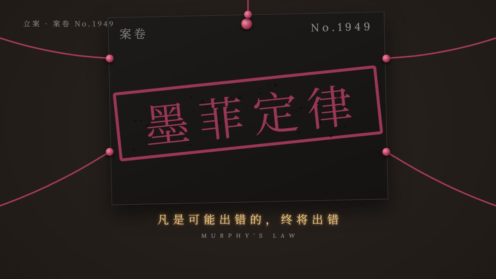
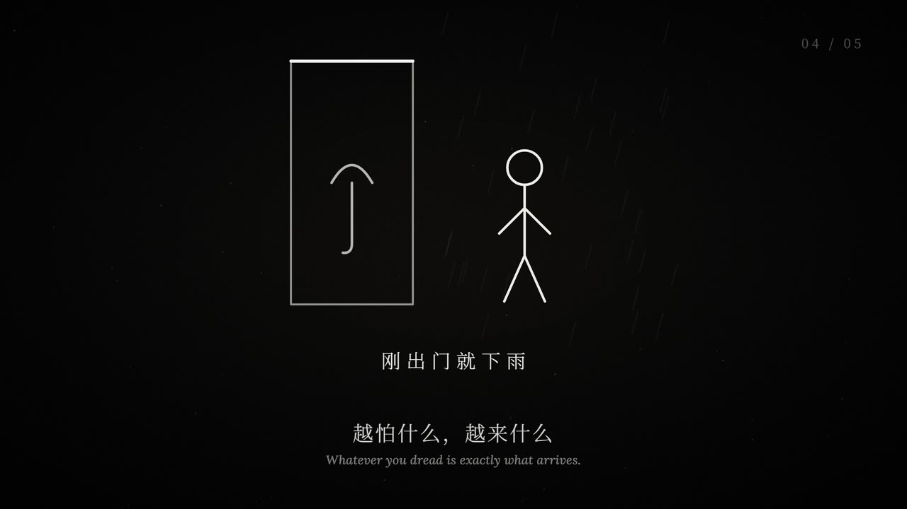
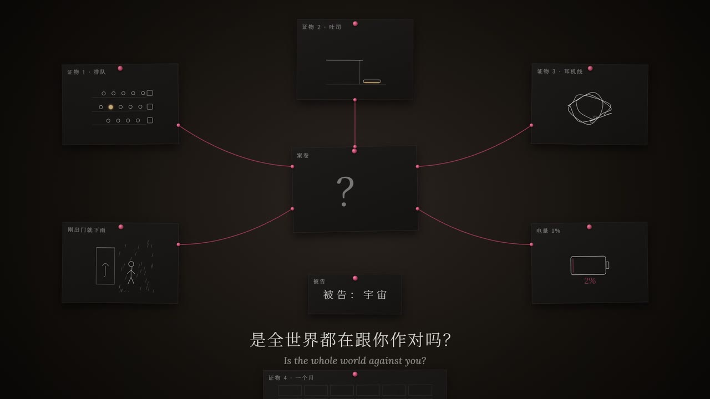
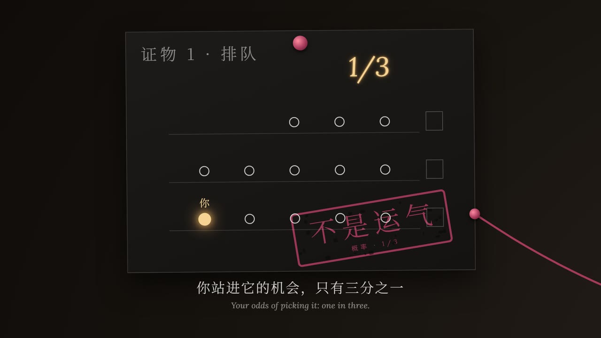
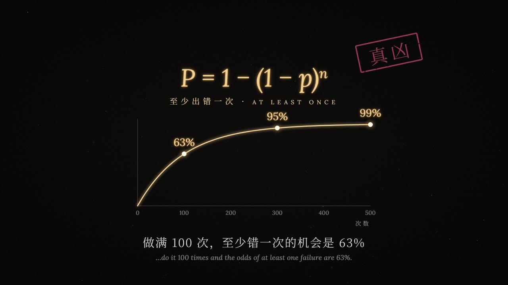
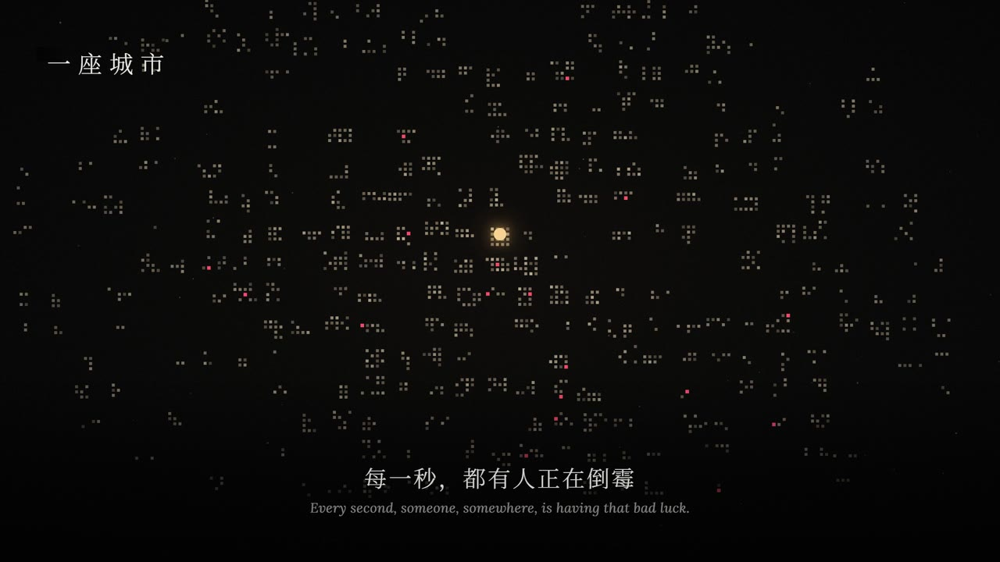
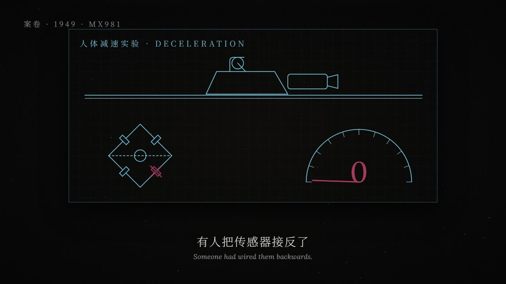
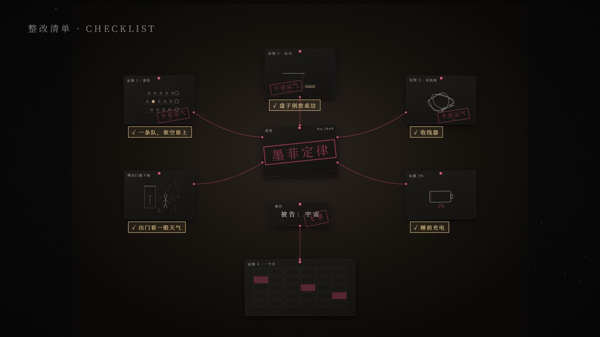

# aliang-knowledge-video



一个 Claude Code skill：输入一个知识主题，自动做出一支「Vibe 知识大赏」风格的中文知识短片（暗底、光、细衬线中英双语字幕、无旁白，画面动作卡音乐节拍，每个视觉事件配真实拟音），直接渲染成 1080p mp4。

每个主题都会按它自己的内容重新设计：开场、叙事形式（侦探调查 / 尺度旅行 / 拆解 / 游戏……）、贯穿全片的画面空间、转场、动效和声音。固定不变的只有品牌风格和背景音乐。

## 效果：《墨菲定律》

只输入了"墨菲定律"四个字。Claude 给它定的方案是一场侦探调查：大家把墨菲定律理解成"倒霉全凭运气"，那就立案、搜证，替"运气"翻案。全片 150 秒，镜头大部分时间在一面案件墙上推拉摇移，三次音乐 drop 分别落在立案盖章、真凶公式、全片唯一的全彩镜头上。

| | |
|:---:|:---:|
|  |  |
| 开场：每小节一件倒霉事，卡 downbeat 硬切 | 案件墙：五件倒霉事钉上墙，红线连向"？" |
|  |  |
| 证物 1：排队，盖章"不是运气 · 概率" | drop 2：公式砸下，曲线画出 63% / 95% / 99% |
|  |  |
| 从一个人拉远到一座城市的灯 | 1949 年的档案：传感器被接反了 |
|  |  |
| drop 3：全片唯一的全彩镜头，火箭滑车冲向日出 | 结尾：每张证物下钉上一条整改，红线变金 |

这只是一个主题的样子。换一个主题，开场、画面空间、转场和声音都会重新设计，不会套用这一套。示例的方案、分镜和场景代码在 [`examples/murphys-law/`](examples/murphys-law/)。

## 安装

```bash
git clone https://github.com/aliangSSS/aliang-knowledge-video.git
```

把整个 `aliang-knowledge-video` 文件夹放进 Claude Code 的 skills 目录：

- 个人（所有项目可用）：`~/.claude/skills/aliang-knowledge-video/`（Windows：`%USERPROFILE%\.claude\skills\aliang-knowledge-video\`）
- 只给某个项目：`<项目>/.claude/skills/aliang-knowledge-video/`

重启 Claude Code 后可用。

## 用法

```
/aliang-knowledge-video 贝叶斯定理
/aliang-knowledge-video 复利 D:\music\another.mp3
```

或者直接说"用 Vibe 风格做一期讲熵的知识视频"。只给主题就行。背景音乐默认用自带的那首（150 秒）；想先看创意方案再出片，就说"先给我看方案"。

产出在 `<主题>-video/` 里：`out/final.mp4`、`out/debug.mp4`（卡点检查版）、`out/contact_sheet.jpg`、`out/qc.txt`，以及创意方案 `notes/treatment.md`、分镜、事实来源、发布文案。渲染速度参考：150 秒的片子在一台 16 GB 内存的 Windows 笔记本上约 5 分钟（成片），调试版再 3 分钟。

## 环境要求

- Claude Code（需要能跑命令、写文件、上网搜索）
- Node.js 18+，Python 3.9+（缺 numpy / scipy / matplotlib / pillow 时会在项目里建 `.venv` 自动装）
- 每个项目约 600 MB 磁盘，全部放在项目目录里，不写系统盘；渲染时浏览器约占 3 GB 内存
- 国内网络：npm 慢就 `npm config set registry https://registry.npmmirror.com`；首次渲染会下载 Chrome Headless Shell（约 270 MB），已有别的 Remotion 4.0.533 项目时会自动复用

## 想改什么

| 改什么 | 在哪改 | 然后 |
|---|---|---|
| 文案、场景顺序、卡点、转场、音效 | `storyboard.json` | `python tools/build.py` → `python tools/render.py` |
| 画面 | `src/scenes/`、`src/World.tsx` | `python tools/preview.py --scenes` 看图 → `render.py` |
| 换 BGM | `python tools/prepare_bgm.py 新曲子.mp3` | 检查分镜的锚点 → `build.py` → `render.py` |
| 音效音量 | 事件的 `gain`，或 `meta.sfxGain`（dB） | `build.py` → `render.py` |

## 目录

```
SKILL.md              Claude 读的主流程
references/           创意设计方法、默认 BGM 结构、视觉系统、节奏与声音、叙事、分镜格式、引擎与组件、自检清单
scripts/              BGM 分析 / 剪接、音效合成 + 拟音、分镜编译 + 转场 + 混音、预览、渲染、自检（复制到每个项目的 tools/）
template/             Remotion 引擎（转场、世界镜头、HUD、震屏）和组件库；没有现成场景
assets/bgm/           默认 BGM
assets/sfx/           280 个拟音采样（Kenney，CC0）
examples/             示例片《墨菲定律》的方案、分镜和场景代码（只作写法参考）
docs/images/          README 截图
```

## 版权与许可

- **代码与文档**：MIT（见 `LICENSE`）。
- **默认 BGM**（`assets/bgm/default.mp3`）：不在 MIT 范围内，版权归其作者。想用自己的音乐：`python tools/prepare_bgm.py <文件>`。
- **拟音**：Kenney（www.kenney.nl）的 Impact / Interface / Sci-Fi Sounds，CC0，可商用、可再分发（许可文件在 `assets/sfx/*/License.txt`）。
- **Remotion** 对个人和 3 人及以下的公司免费，更大的公司商用需要购买许可：https://www.remotion.dev/license
- 字体 Noto Serif SC、Lora：SIL Open Font License，可商用。
- 视频里的事实由 Claude 联网查证并记录来源（`notes/sources.md`），发布前请自己再过一遍。
